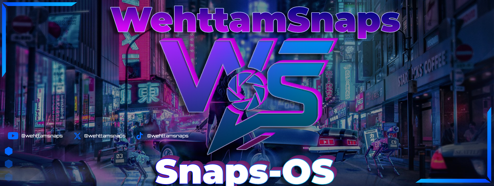

<div align="center">

<a href="https://discord.gg/nTaknDvdUA">
  
</a>

<br><br>


<br><br>



<br><br>

**Bare-metal Void Linux (`glibc` + `runit`) workstation for photography, gaming, and content creation.**


[](https://www.twitch.tv/wehttamsnaps)
[](https://www.youtube.com/@WehttamSnaps)
[](https://github.com/Crowdrocker)

[**Overview**](#-overview) ·
[**Hardware**](#-hardware-target) ·
[**Void adaptations**](#-void-linux-runit-adaptations) ·
[**Install**](#-quick-deploy) ·
[**What the installer does**](#-what-the-installer-does) ·
[**Troubleshooting**](#-troubleshooting) ·
[**Credits**](#-credits)

</div>

---

## ✨ Overview

A Void Linux configuration for the **Umbriel** Wayland compositor and the **iNiR** Quickshell shell, with:

| | |
| :-- | :-- |
| 🪟 **Umbriel + iNiR** | Wayland compositor with a Quickshell-based desktop shell |
| 🔊 **PipeWire dual-PC audio** | Headset and HDMI capture card split for streaming |
| 🎮 **Proton gaming** | Steam, Lutris, Gamemode, MangoHud, 32-bit Mesa/Vulkan ready |
| 🤖 **J.A.R.V.I.S.** | Local voice control (Whisper, Piper, Ollama) |
| 📸 **Creative apps** | Darktable, GIMP, Krita, Inkscape, Kdenlive, OBS |

> [!NOTE]
> Looking for the Arch/Fedora (systemd) version? See [WehttamSnaps-Umbriel](https://github.com/Crowdrocker/WehttamSnaps-Umbriel).

---

## 🖥️ Hardware target

| Component | Specification |
| :-- | :-- |
| **CPU** | AMD Ryzen 5 9600X (AM5) |
| **GPU** | AMD Radeon RX 7600 (RDNA3, Mesa RADV) |
| **Audio** | HyperX Cloud Alpha Wireless + HDMI capture card split (`99-stream-split.conf`) |

---

## 🛠️ Void Linux (`runit`) adaptations

- **No systemd session or autostart.** `qs -c inir`, `awww-daemon`, `xwayland-satellite`, and `/usr/libexec/polkit-kde-authentication-agent-1` are launched directly from Umbriel's `[general] autostart` array inside `dbus-run-session`.
- **Single-instance PipeWire/WirePlumber.** Managed through user `runsv`, with no duplicate spawners in `/etc/pipewire/pipewire.conf.d/`.
- **Ollama as a `runit` service.** A custom `/etc/sv/ollama/run` exposes `/usr/local/bin/ollama` for local `qwen2.5:3b` intent routing.
- **Flatpak and Proton multilib ready.** Ships with TrueType system fonts (`noto-fonts-ttf`, `dejavu-fonts-ttf`, `liberation-fonts-ttf`), `libglvnd-32bit`, `mesa-dri-32bit`, and a `/mnt` sandbox override for Steam out of the box.

---

## 🚀 Quick deploy

```bash
git clone https://github.com/Crowdrocker/WehttamSnaps-Void ~/Documents/GitHub/WehttamSnaps-Void
cd ~/Documents/GitHub/WehttamSnaps-Void
chmod +x install.sh && ./install.sh
```

After it finishes, **log out and back in** so the new groups (`_seatd`, `video`, `render`, `audio`) apply, then pick the **Umbriel** session in SDDM.

> [!WARNING]
> The installer uses `sudo`, enables nonfree/multilib repos, builds software from source, and symlinks into `~/.config`. Existing configs are moved to `~/.config-backup-<timestamp>`, but read the script before running it on a machine you care about.

---

## 📦 What the installer does

| # | Step | Details |
| :-: | :-- | :-- |
| 1 | **Repositories** | Enables `nonfree`, `multilib`, and `multilib-nonfree`, then runs a full system update |
| 2 | **Packages** | Toolchain, Wayland/Qt6 dev libraries, PipeWire, Mesa/Vulkan (64 + 32-bit), fonts, terminals, creative apps, and gaming tools |
| 3 | **Services** | Links `dbus`, `seatd`, `NetworkManager` into `/var/service`; wires ALSA to PipeWire; installs Ollama and its `runit` service |
| 4 | **Source builds** | Builds Umbriel (`just`/`meson`) and Quickshell (`cmake`/`ninja`) into `/usr/local`; installs `matugen` and `xwayland-satellite` via `cargo` |
| 5 | **Fonts and Flatpak** | Installs Material Symbols (Rounded + Outlined), adds Flathub, installs OBS, Discord, Flatseal, and Warehouse |
| 6 | **Dotfiles** | Backs up existing configs, then runs GNU Stow for `umbriel`, `pipewire`, `mangohud`, `fastfetch` |
| 7 | **Session, iNiR, J.A.R.V.I.S.** | Installs the session wrapper and SDDM entry, clones iNiR and community shaders, sets up the voice venv and Piper voice, pulls `qwen2.5:3b` |

<details>
<summary><b>Installed package groups</b></summary>

<br>

| Group | Packages |
| :-- | :-- |
| **CLI** | git, stow, curl, wget, jq, ripgrep, fd, fzf, zoxide, bat, eza, btop, fastfetch |
| **Build** | gcc, meson, ninja, cmake, just, cargo, rust, python3-devel |
| **Wayland / Qt6** | wayland-devel, libxkbcommon, libinput, qt6-base/declarative/wayland/svg/multimedia, qt6ct, kvantum |
| **Audio** | pipewire, wireplumber, alsa-pipewire, pavucontrol, qpwgraph, easyeffects, cava |
| **Graphics** | mesa-dri, mesa-vulkan-radeon, vulkan-loader/tools (64 + 32-bit) |
| **Desktop utils** | wl-clipboard, cliphist, grim, slurp, swaybg, swayidle, swaylock, brightnessctl, playerctl, wlsunset, ydotool |
| **Shell / terminal** | ghostty, yazi, zsh, fish, starship |
| **Creative** | darktable, gimp, krita, inkscape, kdenlive, exiftool, ImageMagick |
| **Gaming** | steam, lutris, gamemode, MangoHud, goverlay, flatpak |

</details>

---

## 🔧 Troubleshooting

```bash
# Check runit service state
sudo sv status /var/service/*

# Restart a service (example: Ollama)
sudo sv restart ollama

# Verify the GPU is using RADV
vulkaninfo | grep deviceName

# Confirm the group changes took effect
id | tr ' ' '\n' | grep -E 'seatd|video|render|audio'
```

If the session won't start, the usual suspects are a missing group (log out and back in), `seatd` not running, or a missing `~/.local/bin/start-umbriel-void`.

---

## 🙏 Credits

- [**Umbriel**](https://github.com/noctalia-dev/umbriel) by the Noctalia team
- [**Quickshell**](https://quickshell.outfoxxed.me/) by outfoxxed
- [**niri**](https://github.com/YaLTeR/niri) by YaLTeR
- [**end-4**](https://github.com/end-4/dots-hyprland) and [**snowarch**](https://github.com/snowarch) for the shell and theming groundwork
- [**Void Linux**](https://voidlinux.org/) for being a great distro

---

<div align="center">

Made with ❤️ by **WehttamSnaps** (Matthew / Crowdrocker)

</div>
