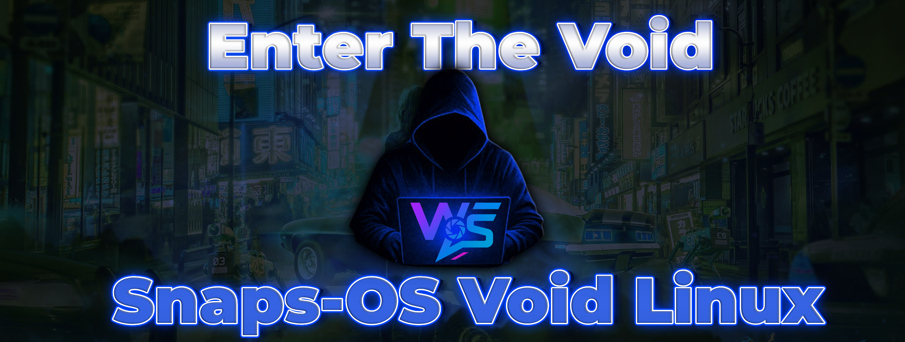

<div align="center">

<a href="https://discord.gg/nTaknDvdUA">
  
</a>

<br><br>


<br><br>



<br><br>

**Bare-metal Void Linux (`glibc` + `runit`) workstation for photography, gaming, and content creation.**


[](https://www.twitch.tv/wehttamsnaps)
[](https://www.youtube.com/@WehttamSnaps)
[](https://github.com/Crowdrocker)

[**Overview**](#-overview) ·
[**Hardware**](#-hardware-target) ·
[**Void adaptations**](#-void-linux-runit-adaptations) ·
[**Install**](#-quick-deploy) ·
[**What the installer does**](#-what-the-installer-does) ·
[**Troubleshooting**](#-troubleshooting) ·
[**Credits**](#-credits)

</div>

---

## ✨ Overview

A Void Linux post-install setup with selectable **Umbriel** or **Niri** desktop
profiles and supporting configs for audio, gaming, and creative work:

| | |
| :-- | :-- |
| 🪟 **Umbriel / Niri** | Selectable Wayland compositor profiles |
| 🔊 **PipeWire** | Audio packages for desktop and streaming workflows |
| 🎮 **Proton gaming** | Steam, Lutris, Gamemode, MangoHud, 32-bit Mesa/Vulkan ready |
| 🤖 **J.A.R.V.I.S.** | Local voice control (Whisper, Piper, Ollama) |
| 📸 **Creative apps** | Darktable, GIMP, Krita, Inkscape, Kdenlive, OBS |

> [!NOTE]
> Looking for the Arch/Fedora (systemd) version? See [WehttamSnaps-Umbriel](https://github.com/Crowdrocker/WehttamSnaps-Umbriel).

---

## 🖥️ Hardware target

| Component | Specification |
| :-- | :-- |
| **CPU** | AMD Ryzen 5 9600X (AM5) |
| **GPU** | AMD Radeon RX 7600 (RDNA3, Mesa RADV) |
| **Audio** | HyperX Cloud Alpha Wireless + HDMI capture card split (`99-stream-split.conf`) |

---

## 🛠️ Void Linux (`runit`) adaptations

- The installer enables available `dbus`, `NetworkManager`, `sddm`, `zramen`, `seatd`, and Bluetooth services through runit.
- It installs multilib Mesa/Vulkan packages for gaming and adds the Flathub user remote.
- The Niri and Umbriel configs are selectable; only the chosen profile is linked into `~/.config`.
- Hardware-specific drive mounts, GPU pinning, and optional iNiR/J.A.R.V.I.S. downloads are intentionally left for separate setup.

---

## 🚀 Quick deploy

```bash
mkdir -p ~/Documents/GitHub
git clone https://github.com/Crowdrocker/WehttamSnaps-Void.git ~/Documents/GitHub/WehttamSnaps-Void
cd ~/Documents/GitHub/WehttamSnaps-Void
./install.sh
```

The script asks whether to install the **Niri** or **Umbriel** profile. To choose without the prompt, use `./install.sh --profile niri` or `./install.sh --profile umbriel`. After it finishes, reboot and choose the matching session in SDDM.

> [!WARNING]
> The installer uses `sudo`, enables nonfree/multilib repositories, updates the system, enables runit services, installs packages, and links configs. Existing matching configs are moved to `~/.config-backup-<timestamp>`. Review the package lists before running it.

See the full [Void Linux post-install guide](docs/01-void-post-install.md) for first-boot steps and details.

---

## 📦 What the installer does

| # | Step | Details |
| :-: | :-- | :-- |
| 1 | **Repositories** | Enables nonfree and multilib repositories and updates the system |
| 2 | **Packages** | Installs common workstation, Wayland, audio, gaming, and creative packages, plus the selected Niri or Umbriel package |
| 3 | **Services and groups** | Enables available runit services, switches enabled DHCP/WPA supplicants off when NetworkManager is configured, and adds available desktop groups |
| 4 | **Flatpak** | Adds the Flathub user remote and installs IDs from `pkglist/flatpak.txt` |
| 5 | **Configs** | Backs up existing matching config paths, then links the selected compositor config and Fastfetch |

<details>
<summary><b>Installed package groups</b></summary>

<br>

| Group | Packages |
| :-- | :-- |
| **CLI** | git, stow, curl, wget, jq, ripgrep, fd, fzf, zoxide, bat, eza, btop, fastfetch |
| **Build** | gcc, meson, ninja, cmake, just, cargo, rust, python3-devel |
| **Wayland / Qt6** | wayland-devel, libxkbcommon, libinput, qt6-base/declarative/wayland/svg/multimedia, qt6ct, kvantum |
| **Common workstation** | CLI tools, build tools, fonts, networking, and Qt/KDE support (`pkglist/base.txt`) |
| **Wayland** | Desktop utilities and common compositor dependencies (`pkglist/wayland-desktop.txt`) |
| **Audio** | PipeWire, WirePlumber, ALSA and Bluetooth audio (`pkglist/audio.txt`) |
| **Creative** | Image/video editing, media and capture applications (`pkglist/creative-apps.txt`) |
| **Gaming** | Steam, Lutris, GameMode, MangoHud, Mesa/Vulkan multilib (`pkglist/gaming.txt`) |
| **Desktop profile** | Niri or Umbriel, selected separately (`pkglist/desktop-*.txt`) |

</details>

---

## 🔧 Troubleshooting

```bash
# Check runit service state
sudo sv status /var/service/*

# Restart a service (example: NetworkManager)
sudo sv restart NetworkManager

# Verify the GPU is using RADV
vulkaninfo | grep deviceName

# Confirm the group changes took effect
id | tr ' ' '\n' | grep -E 'seatd|video|render|audio'
```

If the session won't start, check that its package installed, the session is listed under `/usr/share/wayland-sessions`, and `seatd`/`dbus` are running. Group changes take effect after a full logout or reboot.

---

## 🙏 Credits

- [**Umbriel**](https://github.com/noctalia-dev/umbriel) by the Noctalia team
- [**Quickshell**](https://quickshell.outfoxxed.me/) by outfoxxed
- [**niri**](https://github.com/YaLTeR/niri) by YaLTeR
- [**end-4**](https://github.com/end-4/dots-hyprland) and [**snowarch**](https://github.com/snowarch) for the shell and theming groundwork
- [**Void Linux**](https://voidlinux.org/) for being a great distro

---

<div align="center">

Made with ❤️ by **WehttamSnaps** (Matthew / Crowdrocker)

</div>
